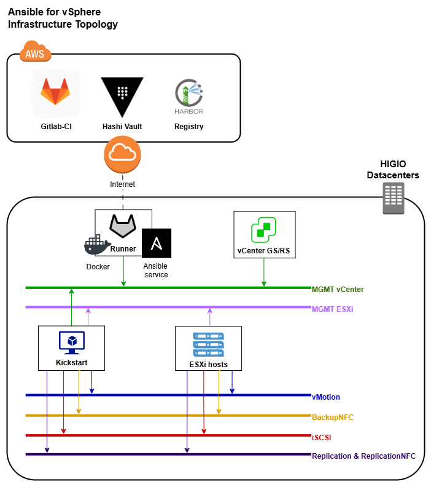
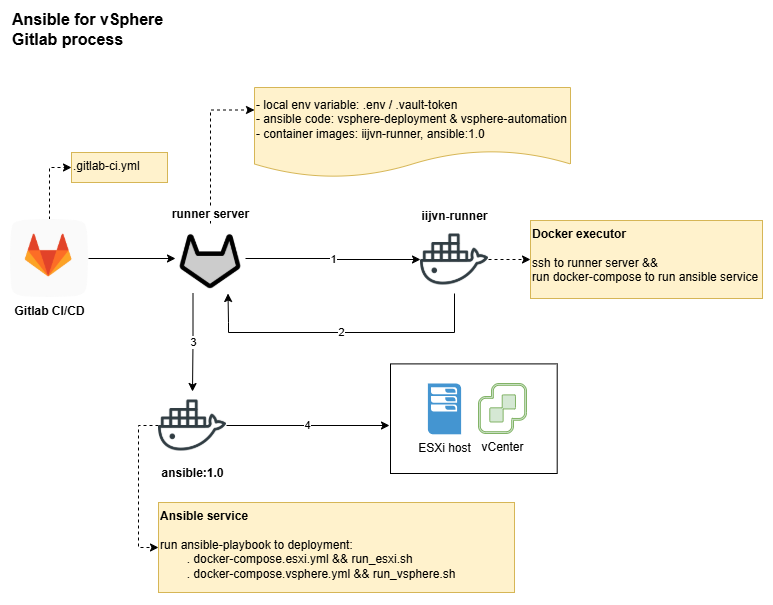
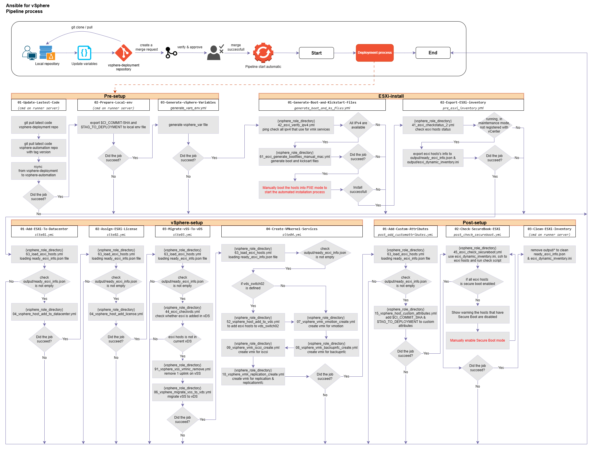

# Ansible for vSphere

## Infrastructure Topology



## Gitlab Workflow



## Gitlab Pipeline Process



## Repositotires

This project comprises two GitLab repositories:

- Repo [vsphere-automation](https://gitlab.iij.com.vn/iijvn-randd/vsphere-automation) : Contains the main code.
- Repo [vsphere-deployment](https://gitlab.iij.com.vn/iijvn-randd/vsphere_deployment) : Stores environment variables and manages the deployment pipeline.

## Environment and Variable directories structure

```plaintext
environments/
├── production/             ==> ANSIBLE_ENVIRONMENT_DEPLOYMENT
│   ├── prd_hcm10gen20/     ==> ANSIBLE_ENVIRONMENT_INVENTORY
│   │   ├── csvdata/        ==> vsphere information (vCenter, ESXi hosts) - modify as necessary
│   │   │   ├── 01_general_data.csv
│   │   │   ├── 02_esxi_data.csv
│   │   │   ├── 03_vcenter_data.csv
│   │   ├── group_vars/
│   │   │   ├── envdir_vars
│   │   │   ├── kickstart_vars ==> DHCP pool configuration - modify as necessary
│   │   ├── hosts
│   ├── prd_fhn05gen20/
│   │   ├── csvdata/
│   │   ├── group_vars/
│   │   ├── hosts
├── lab/
│   ├── lab247_onesw/
│   │   ├── csvdata/
│   │   ├── group_vars/
│   │   ├── hosts         
│   ├── lab247_twosw/
│   │   ├── ...
│   ├── ...
├── ...
group_vars/
├── .gitlab-ci-env.yml ==> variables for pipeline environment - modify as necessary - **important**
├── all
```

## Important Configuration Files

- **group_vars/.gitlab-ci-env.yml**: Variables for GitLab pipeline.
  - Ensure **ANSIBLE_ENVIRONMENT_DEPLOYMENT** and **ANSIBLE_ENVIRONMENT_INVENTORY** match the target environment.
  - Confirm the correct **TAG** version for deployment.
- **group_vars/all**: Global variables, typically no need to modify.

## Steps to Deployment

1. Clone or pull the latest code from the **main branch** of **vsphere-deployment**.

   ```bash
      git clone <repo-url>
      git checkout main
      git pull origin main
   ```

2. Update environment variables and code version as needed:
   - Update variables for the target deployment:
     - vSphere: ESXi target hosts, vCenter details in CSV data files: `01_general_data.csv, 02_esxi_data.csv, 03_vcenter_data.csv`.
     - DHCP pool for PXE and VLAN ID: `kickstart_vars`
   - Update the `.gitlab-ci-env.yml` file:
     - **ANSIBLE_ENVIRONMENT_DEPLOYMENT**: Environment level (e.g., lab, production).
     - **ANSIBLE_ENVIRONMENT_INVENTORY**: Specific inventory to deploy (e.g., prd_hcm10gen20gs, prd_fhn05gen20rs).
     - **TAG**: Code version to deploy.

3. Create new branch and push a merge request.

   ```bash
      git switch -c <new-branch> main
      git add .
      git commit -m "<description>"
      git push origin <new-branch>
   ```

4. Verifying changes in committed code and approving merge requests
   - The pipeline triggers automatically when the merge request is successfully merged.

## Pipeline process

### Stage: Pre-setup

1. **Update Latest Code:**
   - Pull the latest code from both repositories: **vsphere-automation** and **vsphere-deployment**.

2. **Prepare Local Environment Variables:**
   - Adjust .env file like Commit ID, Commit Tag.

3. **Generate vSpherre variable**
   - Create vsphere_vars files to specific environment directory that use for deployment.

### Stage: ESXi-installation

1. **Generate Boot and Kickstart Files:**
   - Configure and generate PXE boot and kickstart files, including DHCP and network parameters.

      > **Manual actions**:
      > The configurations on the physical hosts before PXE boot:
      >
      > - Disable Secure Boot mode.
      > - Identify and configure the VLAN ID for the interface used for PXE > network boot.
      > - Apply and boot the hosts with PXE boot to start the automated installation.

2. **Export ESXi Inventory:**
   - Export inventory esxi hosts which are following the requirements: running, in maintenance mode and not yet registered with vCenter:
      - output/ready_esxi_info.json ==> used for vsphere setup tasks.
      - output/esxi_dynamic_inventory.ini ==> used for run scripts on esxi hosts via ssh.

### Stage: vSphere-setup

1. **Check ESXi hosts status for pre-deployement:**
   - The target ESXi hosts must meet the following conditions:
      - ESXi hosts must be Powered On.
      - ESXi hosts must be in Maintenance Mode.
      - ESXi hosts must NOT be registered with vCenter yet.

2. **Add ESXi Hosts to Datacenter:**
   - Include ESXi hosts in the target vSphere datacenter.

3. **Assign ESXi License:**
   - Apply the appropriate ESXi licenses to the hosts.

4. **Migrate vSS to vDS:**
   - Perform migration from vSphere Standard Switch (vSS) to vSphere Distributed Switch (vDS).

5. **Create VMkernel for Services:**
   - Set up VMkernel adapters for services like vMotion, Backup, iSCSI, Replication.

### Stage: Post-setup

1. **Add Custom Attributes:**
   - **Git Commit ID:** Identifies the pipeline run.
   - **Git Tag:** Indicates the code version deployed.

2. **Check Secure Boot mode on ESXi:**
   - Execute script run on ESXi hosts via SSH and show warning any hosts have the status is disabled.

      > **Manual actions**:
      >
      > - Enable Secure Boot mode.

   - After enabled Secure Boot, run the job to re-check again.

3. **Clean ESXi Inventory:**
   - Remove output/ready_esxi_info.json & output/esxi_dynamic_inventory.ini files.

## Troubleshooting
>
> In boot ESXi step, if the target hosts cannot receive a dynamic IP from DHCP, it could be due to one of the following issues:
>
> - **Network Unreachable**:
>   - Since the port used for PXE boot is in trunk mode, ensure configure the `access VLAN ID` appropriately with DHCP pool.
>   - Re-check firewall service on kickstart server is disabled.
> - **MAC Address Configuration**:
>   - Re-check and ensure the MAC Address of PXE boot interface on the target hosts is correctly defined in the DHCP configuration file (`/etc/dhcp/dhcpd.conf`).
>
---

---
If there are any issues or questions, please contact the R&D team.
