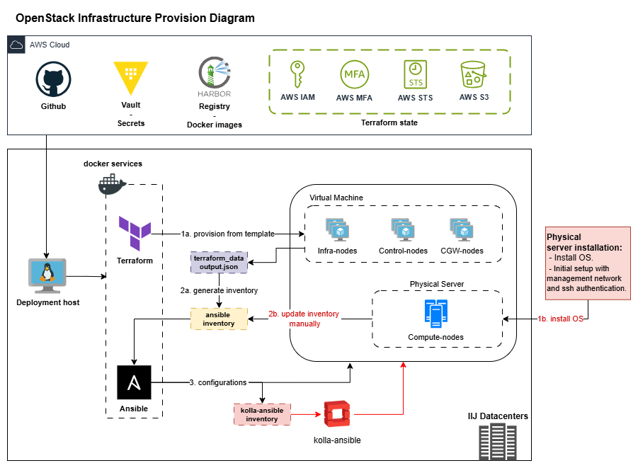

# OpenStack Infrastructure Automation

This repository is used to provision OpenStack infrastructure, prepare hosts, generate Kolla-Ansible configuration, deploy OpenStack services, and run post-deployment configuration and health checks.

## Directory Structure

```text
.
|-- ansible/                    # Ansible logic submodule
|-- deploy/                     # Terraform deployment projects
|-- docs/                       # Deployment and operations documentation
|-- environments/               # Environment-specific variables
|   `-- <ENV>/
|       |-- ansible/
|       |   |-- inventory.ini
|       |   |-- group_vars/
|       |   `-- host_vars/
|       `-- terraform/
|           `-- vms_config.tfvars
|-- output/                     # Artifacts output
|-- sample/                     # Sample local environment files
|-- terraform/                  # Terraform logic submodule
|-- bootstrap_verify.sh         # Verify host preparation
|-- bootstrap.sh                # Fresh host preparation
|-- docker-compose.yml          # Terraform and Ansible container runtime
|-- Makefile                    # Operator command entrypoint
|-- README.md
`-- update_aws_credentials.sh   # Fetch AWS authentication
```

## OpenStack Infrastructure Provision Diagram



## Deployment Host Preparation

### 1. Requirements

- OS support: Ubuntu (versions: 22.04, 24.04)
- Reachable with IIJ services on AWS:
  - Registry: <https://harbor.iij.com.vn>
  - Secret management: <https://vault.iij.com.vn>
- DNS resolved:
  - Registry: <https://harbor.iij.com.vn>
  - Secret management: <https://vault.iij.com.vn>
  - VCSA resource (for terraform provisioning), e.g, `vcenter199.lab.local`
- The following credentials must be available in HashiCorp Vault before deployment:
  - vCSA credential keys: `vcenter_username`, `vcenter_username`.
  - VM template credential keys: `vm_user_login`, `vm_user_password`.
  - VM SSH key pair: `ansible_public_key`, `ansible_private_key`.

### 2. Prepare Git Access

- Refer to document: [Creating a personal access token (classic)](https://docs.github.com/en/authentication/keeping-your-account-and-data-secure/managing-your-personal-access-tokens#creating-a-personal-access-token-classic)
- Scopes: `repo`.

### 3. Clone Repository

Create a working directory.

```bash
sudo mkdir -p /iijvn
```

Clone the repository.

```bash
cd /iijvn
git clone https://github.com/IIJ-Global-Solutions-Vietnam/higio-platform.git
```

### 4. Run Bootstrap

Run the bootstrap script once on the deployment host.

```bash
cd /iijvn/higio-platform/openstack
./bootstrap.sh
```

The script installs and prepares:

- `make`, `git`, `curl`, `jq`
- Docker Engine and Docker Compose plugin
- Vault CLI
- Local files from `samples/`: `.env`, `aws_config`, `aws_credentials`
- Local SSH private key placeholder: `ansible_private_key`

### 5. Update Local Environment Files

Update values to `.env`. This file is required.

Important values:

```bash
### WORKING DIRECTORIES
PROJECT_DIR=.
WORK_DIR=/workspace

### REGISTRY
HARBOR_REGISTRY="harbor.iij.com.vn"
HARBOR_USER="<HARBOR_USER>"
HARBOR_PASSWORD="<HARBOR_PASSWORD>"

### VAULT Authentication
VAULT_ADDR="https://vault.iij.com.vn"
VAULT_TOKEN="<VAULT_TOKEN>"

### TERRAFORM + VAULT
TF_VAR_vault_path_base="<vault-path-base>"
TF_VAR_vault_secret_path="<vault-secret-path>"
TF_VAR_vault_secret_data="<environment-secret-data>"

### ANSIBLE
ANSIBLE_CONFIG=/workspace/ansible.cfg

### AWS S3 Authentication
### Define if the terraform state is stored in AWS S3
# AWS_ACCESS_KEY_ID="${AWS_ACCESS_KEY_ID}"
# AWS_SECRET_ACCESS_KEY="${AWS_SECRET_ACCESS_KEY}"
# AWS_DEFAULT_REGION="${AWS_DEFAULT_REGION}"
# AWS_CONFIG_FILE="/workspace/aws_config"
# AWS_SHARED_CREDENTIALS_FILE="/workspace/aws_credentials"
```

If Terraform state is stored in AWS S3, please also update AWS parameters at:

- `.env`: AWS_ACCESS_KEY_ID, AWS_SECRET_ACCESS_KEY, AWS_DEFAULT_REGION
- `aws_config` and `aws_credentials`

> **NOTE**:
>
> Local secret files already ignored. Please refer to [.gitignore](.gitignore)

> **WARNING**:
>
> Do not commit local secret files:
>
> - `.env`
> - `aws_config`
> - `aws_credentials`
> - `ansible_private_key`

### 6. Prepare resources

Pull image services deployment

```bash
make docker_pull
```

Retrieves the SSH private key for Ansible hosts from Vault and saves it as `ansible_private_key`.

```bash
make vault_get_sshkey
```

### 7. Verify deployment host preparation

Run the `bootstrap_verify.sh` script to verify connectivity, required packages, and local environment files.

```bash
./bootstrap_verify.sh
```

## OpenStack Deployment

Please continue refer to the documents:

- [New deployment process](./docs/deployment/new_deployment.md).
- [Patching for OpenStack 2025.1](./patch_2025.1/patch_2025v1.md).
- [Integrating OpenStack services](./integrate_openstack_services.md).
- [Additional OpenStack nodes](./add_new_node.md).
- [OpenStack deployment operation review and acceptance](./docs/operations/openstack_deployment_operation_acceptance.md).
