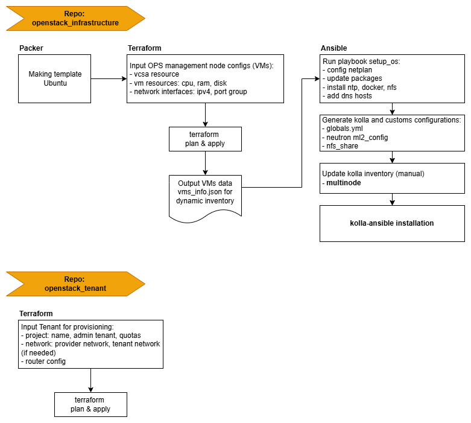

#

## Requirement

- Install packages:
  - docker
  - docker-compose

- Clone repo with submodule:

  ```bash
  git clone --recurse-submodules https://gitlab.iij.com.vn/iijvn-randd/openstack_infrastructure.git
  ```

## Structure

```bash
.
├── ansible     # logic code
├── terraform   # logic code
├── deploy
│   └── openstack_infras_provision # provision openstack management nodes
├── environments
│   ├── lab199
│   │   ├── group_vars
│   │   │   └── all           # variable for setup os, kolla configs
│   │   ├── kolla
│   │   │   └── multinode     # kolla inventory
│   │   ├── dynamic_inv.ini   # dynamic ansible inventory
│   │   └── vms_config.tfvars # variable for provision management nodes
│   ├── dev
│   │   ├── ...
│   └── prod
│       └── ...
├── output
├── Makefile                  # commands to run tasks
├── docker-compose.yml
...
```

## Makefile

- Example topology: 
- Using makefile to run deployment tasks.
  - For new deployment, please refer [new_deployment.md](./docs/new_deployment.md)
  - For add new node to exist system, please refer [add_new_node.md](./docs/add_new_node.md)

## Process


