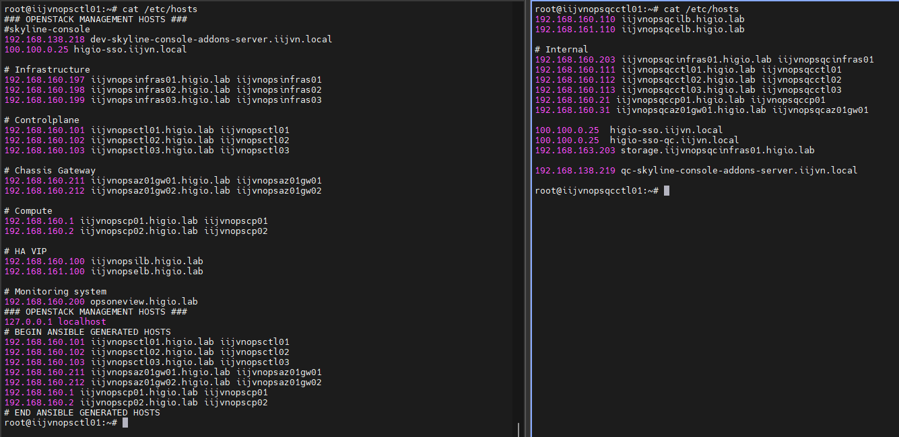
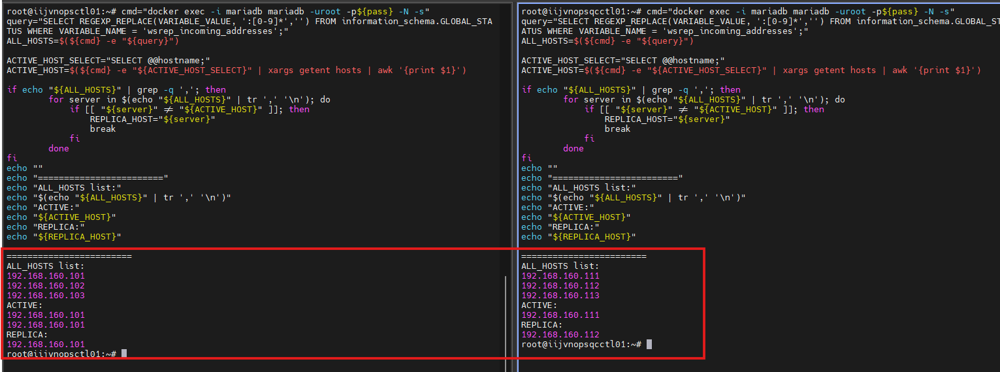

# Kolla-Ansible MariaDB Backup Issue

## Backup proccess flow

### Based on the kolla-ansible code:

By default, backups will be performed on the first node:

<https://github.com/openstack/kolla-ansible/blob/stable/2025.1/ansible/roles/mariadb/defaults/main.yml>

```bash
cat workdir/openstack/os-venv/share/kolla-ansible/ansible/roles/mariadb/defaults/main.yml | grep mariadb_backup_host
...
mariadb_backup_host: "{{ groups[mariadb_shard_group][0] }}"
...
```

The backup target depend on what is the loadbalancer used:

- `haproxy`: OPS version <= 2024.1
- `proxysql`: OPS version >= 2025.1

<https://github.com/openstack/kolla-ansible/blob/stable/2025.1/ansible/group_vars/all.yml>

```bash
cat workdir/openstack/os-venv/share/kolla-ansible/ansible/group_vars/all.yml | grep mariadb
...
mariadb_loadbalancer: "{{ 'proxysql' if enable_proxysql | bool else 'haproxy' }}"
mariadb_backup_target: "{{ 'active' if mariadb_loadbalancer == 'haproxy' else 'replica' }}"
...
```

The backup script also depend on the `mariadb_loadbalancer` value:

<https://github.com/openstack/kolla-ansible/blob/stable/2025.1/ansible/roles/mariadb/tasks/backup.yml>

```bash
cat workdir/openstack/os-venv/share/kolla-ansible/ansible/roles/mariadb/tasks/backup.yml
...
- name: Taking {{ mariadb_backup_type }} database backup via Mariabackup
  vars:
    cmd: "{{ 'kolla_mariadb_backup.sh' if mariadb_backup_target == 'active' else 'kolla_mariadb_backup_replica.sh' }}"
...
```

### So that the backup process flow when using the proxysql in the OpenStack 2025.1 version is:

```text
1. Start mariadbackup service on the first host (controller01).
2. Determine the active host and replica host by running the `kolla_ansible_mariadb_replica.sh` script.
3. Copy the default configuration file (`/etc/mysql/my.cnf`) and update the replica host in the copied configuration.
4. Perform the backup based on the updated configuration file
```

And according to the `get_and_set_replica_server()` function in the [kolla_ansible_mariadb_replica.sh](./assets/kolla_mariadb_backup_replica.sh) script, the result should be:

- Active host: The backup host specified by `mariadb_backup_host`, where the backup script is executed.
- Replica host: The other host in the cluster member list

**The correct workflow:**

```text
Start mariabackup service on the first host.
            |
            v
Determine Active ost and Replica host.
            |
            v
Connect to the Relica host.
            |
            v
Back up data from the Relica host.
```

## Active issue

### Bug report

```text
Bug: [Mariabackup with ProxySQL reads metadata from replica but fails to backup remote data files](https://bugs.launchpad.net/kolla/+bug/2141558).
Date: 2026-02-11
Status: New
Affected version: 2025.1, 2025.2
Related fix proposed to branch: master
Review: <https://review.opendev.org/c/openstack/kolla/+/978300>
```

### Workaround

Follow the comment at <https://bugs.launchpad.net/kolla/+bug/2141558/comments/5>, move the backup process execute directly on secondary node.

1. Change `mariadb_backup_host` to secondary node in `/etc/kolla/globals.yml`

```bash
mariadb_backup_host: "{{ groups[mariadb_shard_group][1] }}"
```

2. Reconfigure mariadb service

```bash
kolla-ansible reconfigure -i multinode -t mariadb
```

## Our environments

### Currently, the backup workflow does not align with the Kolla-Ansible backup process of OpenStack 2025.1

```text
Start mariabackup service on the first host.
            |
            v
Determine Active host and Replica host.
            |
            v
Connect to the Active host.
            |
            v
Back up data from the Active host.
```

### Causes:

- The DNS records are duplicated.
- The `kolla_ansible_mariadb_replica.sh` script does not return the expected result.

The illustration below shows how these issues affect the backup workflow:

(Compares between the DEV and QC environments.)

#### DNS records



#### Result returned by the script



### If apply the correct Kolla-ansible 2025.1 workflow, we needs:

- Remove the duplicate DNS records from all nodes.
- Apply the [workaround](#workaround) until an upstream fix is available.
