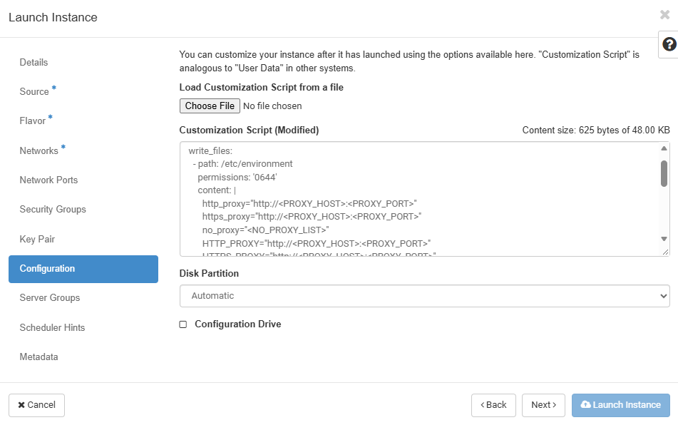

# Migration Infrastructure Preparation for Red Hat os-migrate

Execute the following steps on the **Migrator Host**.

## Prerequisites

Before starting the migration infrastructure deployment, ensure the following requirements are ready.

### Migrator Host

- Prepare a clean Ubuntu VM to use as the **Migrator Host**.
- Ensure Internet access is available for downloading packages, container images, and dependencies.
- Ensure network connectivity from the Migrator Host to:
  - VMware vCenter.
  - OpenStack APIs.
  - OpenStack network used by the Conversion Host.
- Can be hosted in OpenStack.

### OpenStack

- Prepare the network and subnet for the **Conversion Host**.
- Ensure the Conversion Host network can reach:
  - The Migrator Host.
  - VMware/vCenter side.
  - Required OpenStack services.
- Ensure sufficient OpenStack quota is available to create the Conversion Host and related resources.

### Proxy Settings

If the environment requires an HTTP/HTTPS proxy, configure the proxy before installing packages or cloning the repository.

Replace the following placeholders with the values for the target environment:

```bash
<PROXY_HOST>       Proxy server hostname or IP address
<PROXY_PORT>       Proxy server port
<NO_PROXY_LIST>    Hosts, domains, or subnets that bypass the proxy
```

#### 1. System Environment

Configure the system proxy in `/etc/environment`:

```bash
sudo tee -a /etc/environment > /dev/null <<EOF
http_proxy="http://<PROXY_HOST>:<PROXY_PORT>"
https_proxy="http://<PROXY_HOST>:<PROXY_PORT>"
no_proxy="<NO_PROXY_LIST>"

HTTP_PROXY="http://<PROXY_HOST>:<PROXY_PORT>"
HTTPS_PROXY="http://<PROXY_HOST>:<PROXY_PORT>"
NO_PROXY="<NO_PROXY_LIST>"
EOF
```

The `NO_PROXY` list should include internal endpoints that must bypass the proxy, such as VMware, OpenStack, internal domains, internal subnets and metadata endpoints as required.

#### 2. APT Configuration

Configure the APT proxy `/etc/apt/apt.conf.d`:

```bash
sudo tee -a /etc/apt/apt.conf.d/90proxy > /dev/null <<EOF
Acquire::http::Proxy "http://<PROXY_HOST>:<PROXY_PORT>";
Acquire::https::Proxy "http://<PROXY_HOST>:<PROXY_PORT>";
EOF
```

## Setup Migrator Host

### 1. Requirements

- Tested operating systems: Ubuntu (versions: 22.04, 24.04)
- Network connectivity and DNS resolved:
  - vCenter endpoint: as a source migration.
  - OpenStack endpoint: as a destination migration.
- Install `git` and `make` packages to interacte with the repository.

```bash
sudo apt-get update
sudo apt-get install -y git make
```

#### Optional: Bootstrap Proxy Configuration with Cloud-Init

If the environment requires an HTTP/HTTPS proxy and the Migrator Host is created as an OpenStack instance, cloud-init can be used to configure the initial proxy settings and install the required packages automatically.

In the OpenStack UI, input cloud-init configuration into `Launch Instance > Configuration`.



Replace `<PROXY_HOST>`, `<PROXY_PORT>`, and `<NO_PROXY_LIST>` with the values for the target environment.

```bash
#cloud-config

write_files:
  - path: /etc/environment
    permissions: '0644'
    content: |
      http_proxy="http://<PROXY_HOST>:<PROXY_PORT>"
      https_proxy="http://<PROXY_HOST>:<PROXY_PORT>"
      no_proxy="<NO_PROXY_LIST>"
      HTTP_PROXY="http://<PROXY_HOST>:<PROXY_PORT>"
      HTTPS_PROXY="http://<PROXY_HOST>:<PROXY_PORT>"
      NO_PROXY="<NO_PROXY_LIST>"

  - path: /etc/apt/apt.conf.d/90proxy
    permissions: '0644'
    content: |
      Acquire::http::Proxy "http://<PROXY_HOST>:<PROXY_PORT>";
      Acquire::https::Proxy "http://<PROXY_HOST>:<PROXY_PORT>";

package_update: true

packages:
  - git
  - make
```

After the instance is ready, verify that cloud-init completed successfully:

```bash
cloud-init status --wait
```

Then verify the required packages and proxy settings:

```bash
git --version
make --version
env | grep -i proxy
```

### 2. Prepare Git Access

- Refer to document: [Creating a personal access token (classic)](https://docs.github.com/en/authentication/keeping-your-account-and-data-secure/managing-your-personal-access-tokens#creating-a-personal-access-token-classic)
- Scopes: `repo`.

### 3. Clone Repository

Create a working directory.

```bash
sudo mkdir -p /iijvn
```

Clone the repository.

```bash
cd /iijvn
git clone https://github.com/iij-p2-gen2/p2op-vn.git p2op-vn
```

### 4. Run setup

Change directory to the root repository:

```bash
cd /iijvn/p2op-vn/products/vmware-migration/migration-tools/osmigrate
```

Set the target environment name before running the migration commands:

```bash
export ENV=<TARGET_ENVIRONMENT>
```

`<TARGET_ENVIRONMENT>` must match the name of the target environment directory under `environments/`.

Run the script on the migrator host.

```bash
make build_migrator
```

The script installs and prepares:

- `curl`, `jq`, `tree`, etc.
- Python, pipx, and `ansible-builder`.
- Docker Engine and Docker Compose plugin.
- Copy `sample/sample_environment` to `environments/sample_environment`

## Declare Environment Variables

Copy `environments/sample_environment` to `environments/$ENV`

```bash
cp -r environments/sample_environment environments/$ENV
```

Copy `environments/$ENV/.env.sample` to `environments/$ENV/.env`

```bash
cp environments/$ENV/.env.sample environments/$ENV/.env
```

Update the `environments/$ENV/.env` file with the predefined parameters.

```bash
### GENERAL
WORK_DIR="/workspace"

# Target environment directory under environments/.
# Example:
#   environments/dev-env
#
# Set TARGET_ENVIRONMENT to the directory name only.
# TARGET_ENVIRONMENT="dev-env"
TARGET_ENVIRONMENT="<TARGET_ENVIRONMENT>"

### VMWARE CONFIGURATION
VMWARE_HOST="<VCENTER_HOST>"
VMWARE_USER="<VCENTER_USERNAME>"
VMWARE_PASSWORD="<VCENTER_PASSWORD>"
VMWARE_DATACENTER="<VMWARE_DATACENTER>"

# Example: /Datacenter/vm/APP/IAC
VMWARE_SEARCH_PATH="<VM_FOLDER_PATH>"

# Contain data collected during migration process.
VMWARE_DATA_DIR="/opt/os-migrate"

### OPENSTACK CONFIGURATION
# OS_AUTH_URL: https://openstack.example.com:5000
# Check URL with:
#   openstack endpoint list --service identity
OS_AUTH_URL="<KEYSTONE_IDENTITY_URL>"

OS_USERNAME="<TENANT_ADMIN>"
OS_PASSWORD="<TENANT_PASSWORD>"
OS_USER_DOMAIN_NAME="<TENANT_USER_DOMAIN_NAME>"

OS_PROJECT_ID="<TENANT_PROJECT_ID>"
OS_PROJECT_NAME="<TENANT_PROJECT_NAME>"
OS_PROJECT_DOMAIN_NAME="<TENANT_PROJECT_DOMAIN_NAME>"

OS_REGION_NAME="<TENANT_REGION_NAME>"

# Example: public or internal
OS_INTERFACE="<INTERFACE>"

OS_IDENTITY_API_VERSION="3"

# Remove this variable if the environment does not use a custom CA certificate.
# Because of using AEE, the CA certificate path refers to the path inside the AEE image.
OS_CACERT="/etc/pki/tls/certs/ca-bundle.crt"

### OPENSTACK CONVERSION HOST INSTANCE
CONVERSION_HOST_NAME="<CONVERSION_HOST_NAME>"
CONVERSION_NETWORK="<TENANT_OPENSTACK_NETWORK>"
CONVERSION_STATIC_IP="<TENANT_OPENSTACK_STATIC_IP>"
CONVERSION_FLOATING_IP="<TENANT_OPENSTACK_FLOATING_IP>"

### PROXY CONFIGURATION
# Leave empty if proxy is not required.
# PROXY_URL=""
# NO_PROXY=""
PROXY_URL="http://<PROXY_HOST>:<PROXY_PORT>"
NO_PROXY="<NO_PROXY_LIST>"
```

Configure DNS records for VMware and OpenStack endpoints in `/etc/hosts`.

```bash
### VCENTER ENDPOINT ###
{{ vcenter_ip }} {{ vcenter_fqdn }}

### OPENSTACK ENDPOINT ###
{{ openstack_ip }} {{ openstack_fqdn }}
```

If the environment requires a proxy, configure the Docker proxy settings:

```bash
make configure_docker_proxy ENV=$ENV
```

## Update CA Certificates

**AEE Image** — used by Ansible/os-migrate to securely access VMware and OpenStack APIs.

**Conversion Host** — used during VM disk transfer and conversion operations.

Store the CA certificates in the following directories:

```bash
infra_os_migrate/
└── certs/
    ├── vmware/
    │   └── <VMWARE_CA_CERTIFICATE>.crt
    └── openstack/
        └── <OPENSTACK_CA_CERTIFICATE>.crt
```

When a CA certificate is renewed or replaced, update the corresponding certificate file and rebuild/reconfigure the affected migration components.

## Setup Ansible Execution Environment (AEE)

> **[NOTE]**
>
> For AEE dependencies, certificates, and configuration details, refer to:
>
> [Ansible Execution Environment for OS Migrate.](./infra_os_migrate/aee/README.md)
>

### Build AEE Image

Run the following command on the **Migrator Host** to build AEE image:

```bash
make build_aee
```

## Setup Conversion Host

### 1. Requirements

- Deployed in the OpenStack environment.
- Supported operating systems:
  - Centos Stream 10 (used in this document).
  - RHEL 9.5.
- The OpenStack network must be ready for use by the conversion host.
- Other OpenStack resources, such as the image, flavor, and SSH key pair, will be created if needed during the setup process.
- Download/upload the VMware VDDK library package and place it in `/tmp/`. The version used in this document is `VMware-vix-disklib-8.0.3-23950268.x86_64.tar.gz`.

### 2. Deploy Conversion Host

Configure the `CONVERSION_*` parameters in the `.env` file if they are not already defined.

```bash
### OPENSTACK CONVERSION HOST INSTANCE
CONVERSION_HOST_NAME="<conversion_host_name>"
CONVERSION_NETWORK="<openstack_network_name>"
CONVERSION_STATIC_IP="<openstack_static_ip>"
CONVERSION_FLOATING_IP="<openstack_floating_ip>"
```

Configure DNS records for VMware and OpenStack endpoints, edit dns config file:

```bash
nano environments/$ENV/group_vars/dns.yml
```

```bash
### DNS records
vcenter_ip: <vcenter_ip>
vcenter_fqdn: <vcenter_fqdn>

openstack_ip: <openstack_ip>
openstack_fqdn: <openstack_fqdn>
```

Run the following command on the **Migrator Host** to deploy the Conversion Host:

```bash
make build_conversion ENV=$ENV
```

The deployment process will:

- Upload the CentOS image.
- Create the required flavor.
- Create the security group.
- Create the SSH key pair.
- Deploy the Conversion Host instance.
- Generate Ansible inventory.
- Validate SSH connectivity from the AEE.
- Continue post-deployment configuration using Ansible tasks.

### 3. Update Conversion Host Configuration

To update or reapply the Conversion Host configuration without redeploying the instance, run:

```bash
make setup_conversion ENV=$ENV
```

The configuration process includes:

- DNS configuration.
- CA certificates.
- VMware VDDK library.
- Other Conversion Host configurations managed by Ansible.

## Validate connectivity

Run the following command to validate connectivity from the AEE to VMware and OpenStack:

```bash
make validate_connectivity ENV=$ENV
```

The validation includes:

- VMware connectivity and authentication.
- OpenStack connectivity and authentication.
- SSL/TLS certificate validation.

## If all preparation steps are completed successfully, the environment is ready to start the migration process.

Continue with the [Red Hat os-migrate VM Migration Guide](./os_migrate_vm_migration.md) to perform the VM migration.

## Troubleshooting

- [KB001 - OpenStack Connection Error During Conversion Host Creation.](../kb/kb001-conversion-connection-error.md)
- [KB002 - Missing VMware VDDK Library Package.](../kb/kb002-vddk-missing.md)
- [KB004 - Ansible Galaxy Collection Download Issue](../kb/kb004-ansible-collection-download-issue.md)